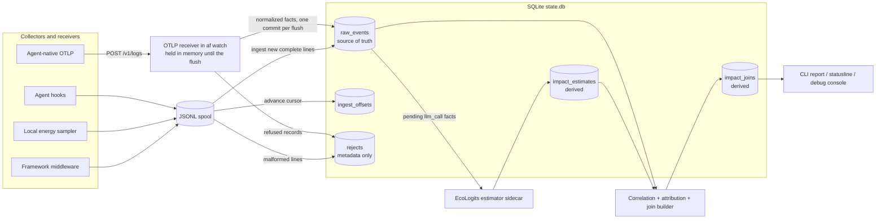
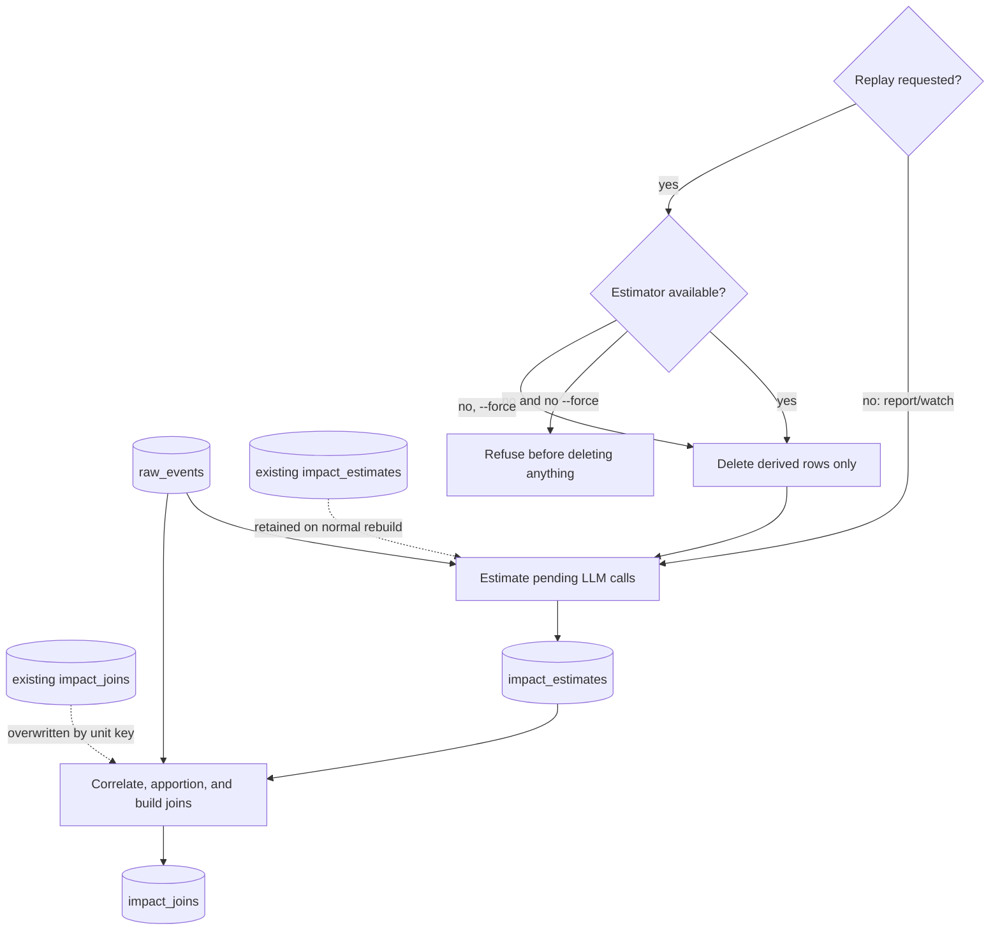
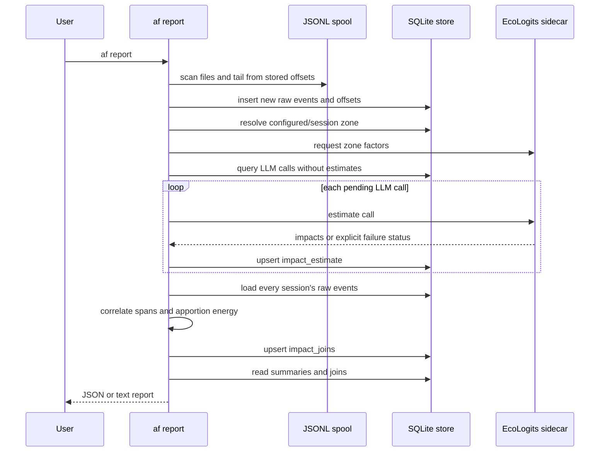
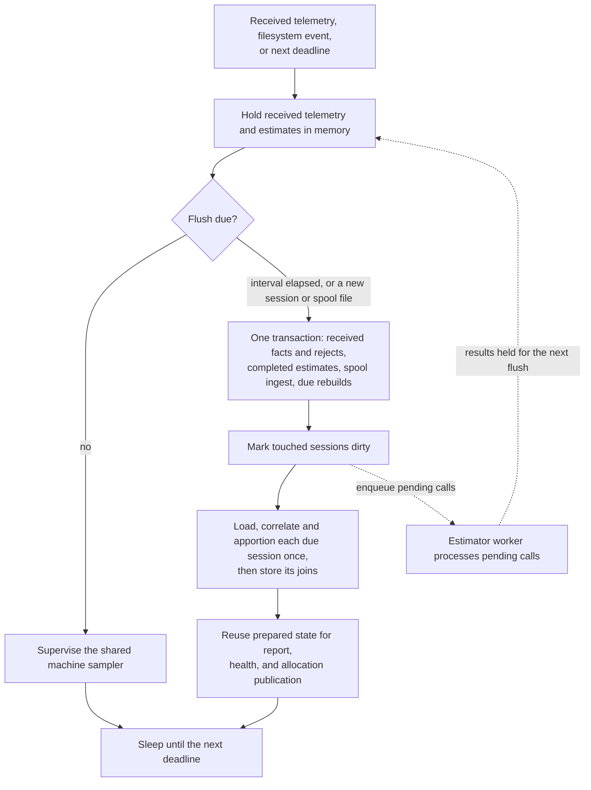

# Rebuild architecture and tracker data flow

This note explains what **rebuild** means in agentic-footprint, how it differs
from ingestion and replay, and how facts move through the tracker.

## The short version

The tracker stores two kinds of data:

1. **Raw facts** are observations emitted by collectors: LLM calls, action
   spans, machine-energy windows, process samples, and session metadata.
2. **Derived views** are the current interpretation of those facts: remote
   impact estimates and joined session/task/tool footprints.

Raw facts are the source of truth. Derived views are disposable caches. A
**rebuild** reads the raw facts and regenerates the derived views under the
current estimation methodology, attribution policy, and electricity zone.

There are two transports. File-based collectors (the Claude Code hook, the
CodeCarbon sampler, the experimental OpenCode collector) append JSONL to
`$AF_STATE_DIR/spool/<collector>.<session>.jsonl`. OTLP telemetry (Claude
Code and Codex token usage and LLM calls) is posted to the receiver inside
`af watch`, which normalizes it and writes it straight into `raw_events`; it
never touches the spool. Within `af watch` the loop owns the one database
connection, so the receiver hands its facts to that loop through a bounded
queue rather than writing anything itself; when the queue is full it answers
with a retryable `503`.

## The three operations people often confuse

### Ingest

Ingestion moves newly appended, complete JSONL lines from the spool into
`raw_events`. Per-file byte positions are stored in `ingest_offsets`, so the
next pass should only consume appended bytes.

Ingest does **not** calculate environmental impact.

A line that does not parse, or an OTLP record the receiver refuses, becomes a
row in the `rejects` table: when, the source, the reason, the attribute
names, and the size in bytes. The content itself is not kept anywhere,
because a rejected batch can carry tool arguments, command output, or
account identifiers. The table keeps the newest 1,000 rows (`REJECT_RING` in
`crates/af-store/src/rejects.rs`).

### Rebuild derived views

`rebuild_derived` is the calculation pipeline. It:

1. obtains electricity-mix factors when an estimator is available;
2. estimates any `llm_call` that has no stored estimate yet;
3. loads every session's raw events;
4. correlates action spans into a session tree;
5. apportions local energy samples to those spans;
6. combines local measurements and remote estimates;
7. upserts session/task/tool records into `impact_joins`.

Despite its name, a normal rebuild does **not** delete raw events, reread the
whole spool, or normally delete existing estimates. It recomputes the joined
view, while only estimating the remote calls still missing an estimate.

### Replay

`af replay` is a destructive rebuild of **derived data only**. It first clears
`impact_estimates` and `impact_joins`, then runs the same calculation pipeline
from the retained `raw_events`.

Replay exists so a methodology or attribution-policy update can be applied to
history without recollecting the original observations.

## What `af report` does

`af report` is not read-only. It performs an on-demand update before printing:

The important consequence is that report latency scales with the outstanding
estimation backlog and with all retained sessions that are rebuilt.

`af report` reads only the spool and the store. Telemetry that a running
`af watch` has received but not yet flushed is still in that process's memory,
so a report can lag the receiver by up to one flush interval (see below).

## What `af watch` does today

The resident tracker wakes on received telemetry, on a spool change, or on
its next deadline, and writes in batches: everything it has to write since
the last flush goes into the store in one transaction.

### Why writes are batched

Every SQLite commit in WAL mode writes whole pages twice, once to the WAL and
again when it is checkpointed into the database. For a process that stays
resident all day, disk wear follows the number of commits, not the volume of
telemetry: sampler windows land every few seconds and Claude Code exports
every two, and at a 10-second flush a day of work measured about 600 MiB of
physical writes. So `af watch` commits once per flush:

- the flush interval is 60 seconds (`DEFAULT_BATCH_INTERVAL_MS` in
  `crates/af-cli/src/cmd/watch.rs`; the hidden `--batch-interval-ms` flag
  changes it, and tests pass 0);
- something new is written at once: a session or spool file this watch has
  not seen yet, or a burst of 5,000 received events, so a new session's
  sampler and first rebuild are not delayed;
- a session that gained new facts (LLM calls, spans, metadata) is rebuilt at
  most once per interval; one that only gained energy samples waits six
  intervals (`SAMPLE_REBUILD_FACTOR`);
- the full-directory spool reconciliation runs every 30 seconds
  (`RECONCILE`), but it too waits for a flush;
- a clean stop (`Ctrl-C`, or `SIGTERM` from a service stop or restart)
  stores what the receiver had queued, runs a final ingest pass, and rebuilds
  every dirty session before exiting.

The trade-off is staleness and a bounded loss window. The status line and the
debug console show numbers up to one interval old (sample-only energy up to
six), and `af report`, which ingests the spool itself, lacks the OTLP
telemetry the watch has not flushed yet. Received OTLP telemetry not yet flushed exists only in
memory, and the receiver has already answered the exporter with success, so a
crash or `kill -9` loses up to one interval of it. Spool data is not at risk
the same way: its lines stay on disk and its cursor advances only in the
commit that stored them, so the next start re-ingests them. If the store
refuses a flush (locked, disk full), the received facts are kept in memory and
retried, up to 50,000 events.

The resident path is deliberately scoped and non-blocking:

- only sessions changed by ingestion, sampling, or completed estimates are
  rebuilt;
- each touched session's event history is loaded once per pass;
- correlation and energy apportionment are computed once into a prepared
  session and reused for join storage and debug publication;
- remote estimation runs in a worker, so slow model-impact estimation does not
  block ingestion or the receiver;
- completed estimates schedule another rebuild only for the affected sessions.

`af report` and `af replay` still use the complete-store pipeline because they
must present or regenerate a coherent view of retained history. The optimized
watch path changes scheduling and reuse, not the raw/derived contracts or the
attribution result.

## Why diagnostics are on demand

The debug console shows per-event decisions, allocation traces and collector
health. Building them costs work on every pass, and a background service runs
all day with nobody looking. So the resident `af watch` builds none of it
until a console attaches:

- the background service listens on no debug TCP port. It serves the debug
  API on `console.sock`, a socket in the state directory that only its owner
  can open, because the API exposes session data and has no authentication;
- `af console` attaches by holding a stream open on that socket. While no
  stream is open, the collector builds no frames and no decisions, and does
  not re-detect agent processes;
- a console that attaches is told the present: the status, the list of stored
  sessions, and the last three minutes of each active session. The store may
  hold days of history, and replaying it would delay the first page for
  little use. Older sessions are loaded one at a time, when asked for;
- loading a session for a console only reads what the store holds. A
  console's request never changes a stored result;
- when the last console leaves, the collector discards what it had built,
  since it would only go stale.

`af watch --debug` keeps the earlier behaviour for development: a TCP debug
port, and diagnostics built for the life of the process. The routes and
frames are in the [debug API reference](../reference/debug-api.md), and
[Open the debug console](../how-to/debug-console.md) shows how to use it.

## Why keep raw and derived data separate?

### Methodology upgrades

An EcoLogits version, model dataset, electricity factor, or attribution policy
can change. Keeping raw observations allows the project to recalculate history
instead of permanently freezing the first answer it produced.

### Honest degradation

Local measurement does not depend on the remote-impact estimator. If Python or
EcoLogits is unavailable, joins can still report local energy while remote
calls remain explicitly `pending`.

### Auditability

A derived footprint can be traced back to the exact raw calls, spans, process
samples, and energy windows that produced it.

### Multiple presentation layers

The statusline, CLI report, debug console, and a future remote exporter can all
read the same stored derived view instead of implementing environmental
methodology independently.

## What is truly rebuildable?

| Data | Deleted by normal report/watch? | Deleted by replay? | Reconstructable from raw facts alone? |
|---|---:|---:|---:|
| JSONL spool | No | No | Original transport for hooks, the sampler, and OpenCode (OTLP telemetry is not spooled) |
| `raw_events` | No | No | Source of truth |
| `ingest_offsets` | No | No | Operational cursor, not an impact result |
| `rejects` | Trimmed to the newest 1,000 | No | No: metadata only, the rejected content is never kept |
| `impact_joins` | Overwritten by key | Yes | Yes |
| `impact_estimates` | Existing rows retained; missing rows added | Yes | Only with the estimator and its methodology/data available |

The final row explains the replay safety check: deleting estimates without a
working estimator would remove information the Rust core cannot regenerate by
itself. Replay therefore refuses before deletion unless `--force` is explicit.

## A useful mental model

Think of the system as a small event-sourced application:

- the spool is the transport log for file-based collectors, and the OTLP
  receiver is a second, in-memory transport into the same ledger;
- `raw_events` is the durable fact ledger;
- `impact_estimates` is a methodology-dependent enrichment cache;
- `impact_joins` is a materialized read model;
- rebuild is materialized-view refresh;
- replay is dropping and regenerating the methodology-dependent views.

That model also suggests the main performance direction: preserve the immutable
fact ledger, but track which sessions and derived units are dirty so ordinary
watch passes refresh only affected materialized views.
